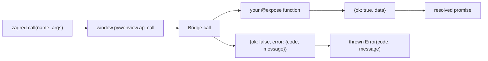

# Zagred

**Desktop apps with a Python backend and a web frontend.**

Your app is a normal Python package. Your UI is a folder next to it. Zagred puts
the two together in a native window (via [pywebview](https://pywebview.flowrl.com))
and compiles the result into a `.AppImage`, `.exe`, `.app` or `.dmg`
(via [Nuitka](https://nuitka.net)).

Your `app.py`:

```python
import zagred

app = zagred.App(title="Notes", size=(1024, 700))


@app.expose
def greet(name: str) -> str:
    return f"Hello, {name}!"


@app.on_start
def boot() -> None:
    print("window is up")
```

Your `index.html`:

```html
<script>
  const msg = await zagred.call("greet", { name: "world" });
</script>
```

That is the whole idea: one decorator per function the UI may call, one
`zagred.call()` per call, typed errors in between.

## Why

| | Zagred | Electron | Tauri |
|---|---|---|---|
| Backend language | Python | Node | Rust |
| Runtime to ship | WebView + Python | Chromium + Node | WebView + Rust |
| Build tool | Nuitka | electron-builder | cargo |
| Frontend | any, or plain HTML | any | any |

No Rust, no Node.js unless you want a bundler. The GTK backend is used on Linux
on purpose: Qt would add 80–150 MB to every build.

## Install

```bash
uv tool install zagred      # not on PyPI yet — see Getting started
zagred new                  # interactive: name, framework, JS or TS
cd my-app
uv sync
uv run zagred dev
```

Continue with [Getting started](getting-started.md).

## How it works

Every JS → Python call goes through one door:



Your code never touches `window.pywebview`. The `window.zagred` shim is injected
on `before_load` from a worker thread — calling `evaluate_js` directly on that
blocking event deadlocks the GTK main loop and leaves the window white.

## Requirements

| OS | Needs |
|---|---|
| Linux | `libwebkit2gtk-4.1`, `python3-gi`, venv created with `--system-site-packages`; `patchelf` comes with `--group build` |
| Windows | WebView2 runtime (preinstalled on Windows 11) |
| macOS | nothing extra |

Python 3.12+ and [uv](https://docs.astral.sh/uv/). Cross-compiling is not
possible — build each OS on that OS, or in CI.
